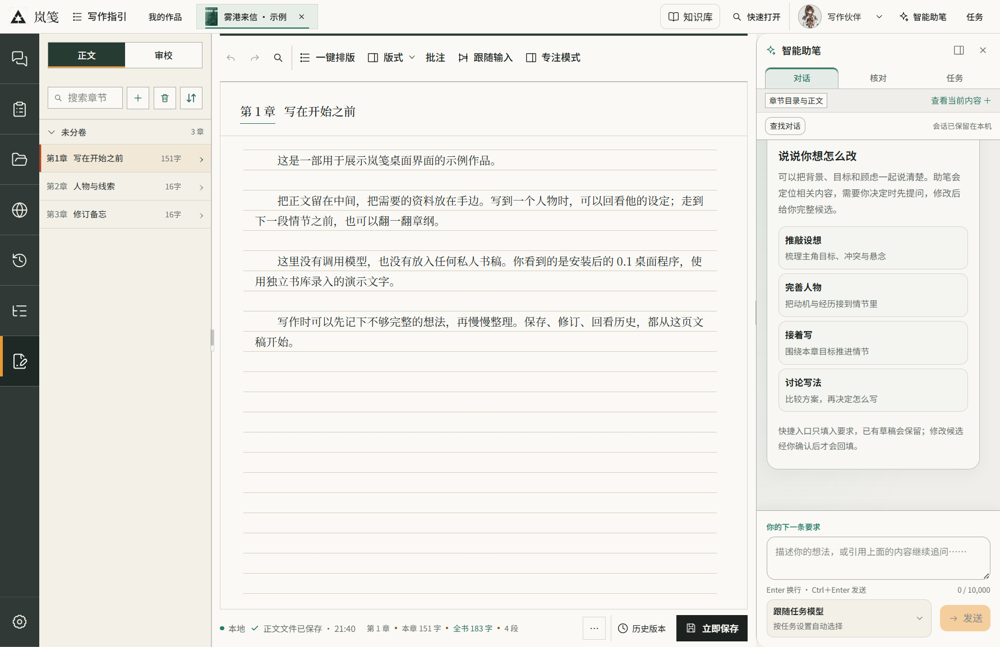

# Lanjian · 岚笺

[中文（主要文档）](README.md)

A local desktop workspace for long-form fiction: references, worldbuilding, event timelines, layered outlines and manuscripts.

**Version 0.1.3 is a development preview**, not acceptance of every V3 capability.

- [Try the hosted application](https://lanjian.jiangai.space/)
- [Download the Windows x64 installer](https://github.com/jianghaisi/lanjian/releases/tag/v0.1.3)
- [Chinese installation and development guide](README.md#快速开始)
- [Deployment](docs/DEPLOYMENT.md)
- [Contributing](CONTRIBUTING.md)

These are actual Windows desktop 0.1.0 screenshots captured on 2026-10-12 with a separate demonstration library. They contain no private manuscripts or simulated model responses. The [Chinese README](README.md#看看桌面端) includes the project motivation and a walkthrough of eleven desktop modules and views.

Lanjian brings manuscripts, notes, characters and outlines into one book workspace, so long-form writing involves less searching across documents and chat histories. Manual writing works without an AI connection. When using AI, candidates require author review, and current outlines must be explicitly confirmed before corresponding prose generation.

Use Node.js 24 LTS to develop. Build the shared packages before installing and starting desktop; exact commands are maintained in the Chinese README. End users do not need Node.js.

The full test suite also requires Python 3.10+ (3.12 in CI), using only the standard library. Set `LANJIAN_TEST_PYTHON` to an interpreter path when needed; no model downloads are required for tests.

Original source code is under [MIT](LICENSE). Third-party software and non-code assets retain their own terms; see [asset scope](ASSETS.md) and [third-party notices](desktop/licenses/THIRD-PARTY-NOTICES.md).
