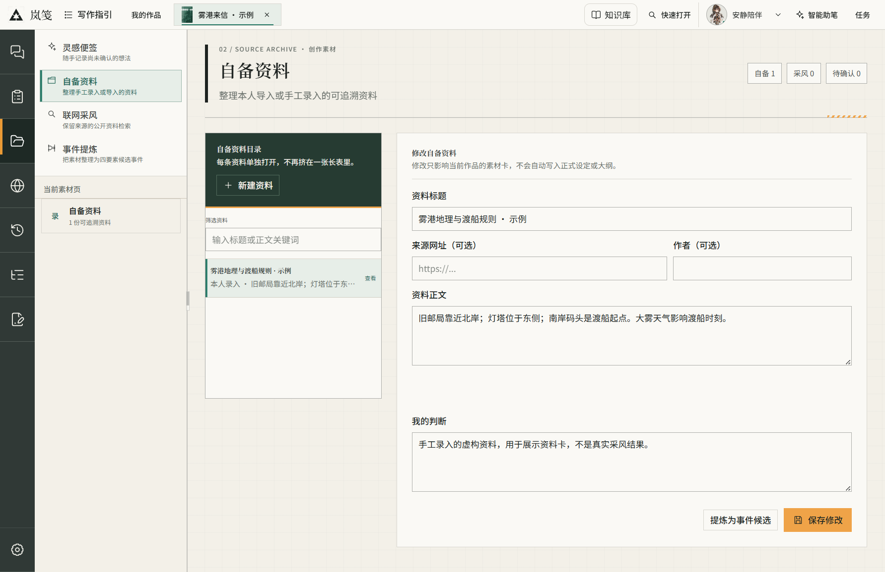
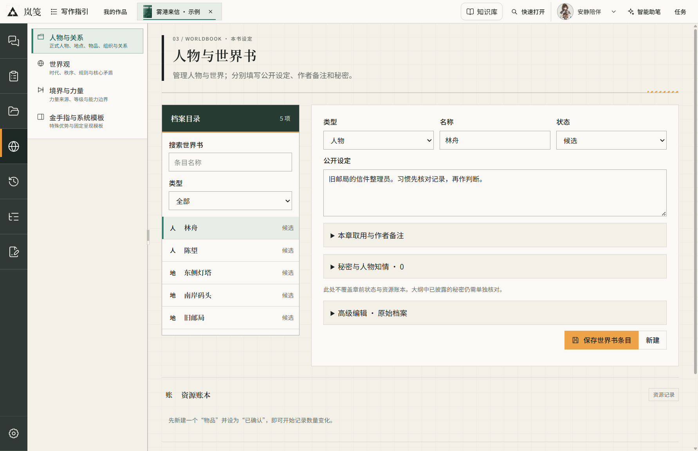
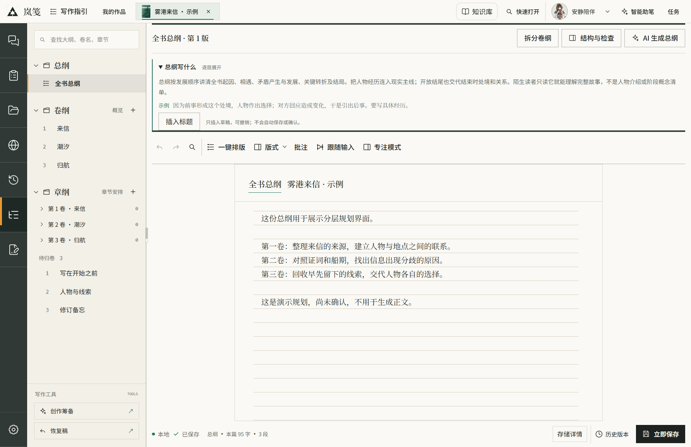
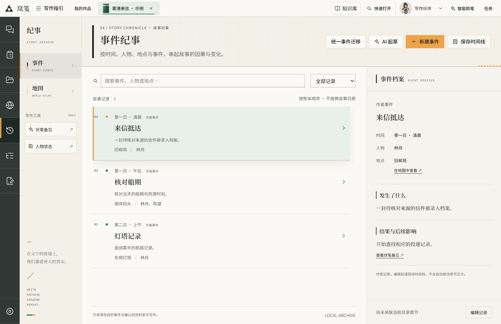
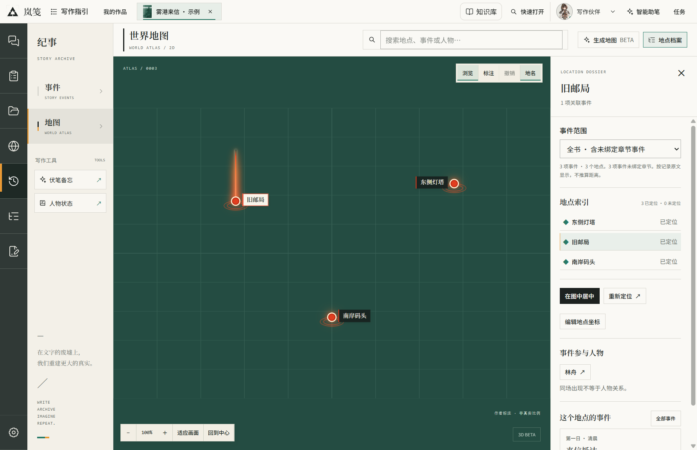
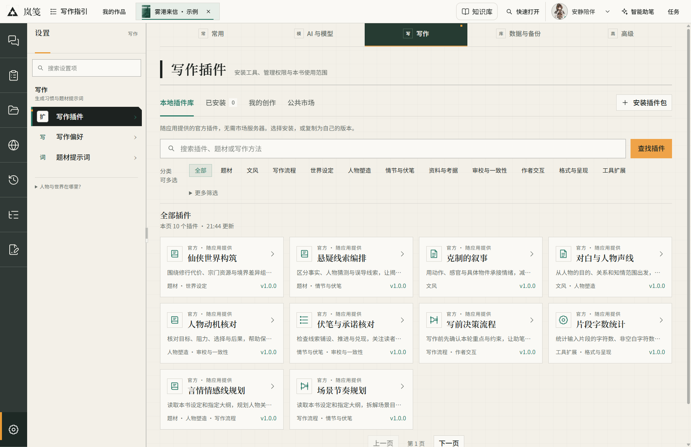
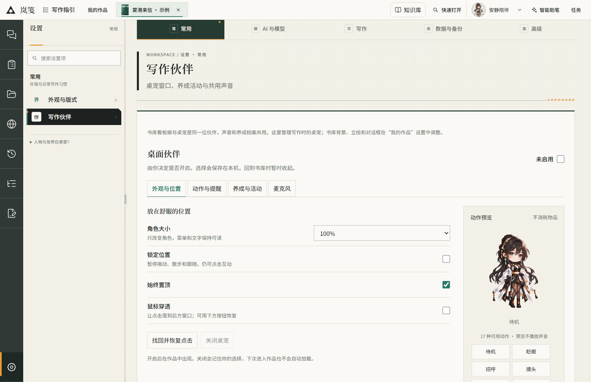

<h1 align="center">岚笺 · Lanjian</h1>

面向长篇小说创作的本地桌面工作台。

<a href="https://github.com/jianghaisi/lanjian/releases/tag/v0.1.1"><strong>下载 Windows 安装包 ↗</strong></a> · <a href="https://lanjian.jiangai.space/"><strong>在线试用 ↗</strong></a> · <a href="README.en.md">English</a>

岚笺是一款本地小说写作工具。正文、资料、人物设定、大纲和故事事件，都放在同一部作品里。可以自己写，也可以接入模型，找助笔讨论一段情节，再决定哪些内容留下。

目前发布 **0.1 开发预览版**，提供 Windows x64 安装包。还有不少细节需要打磨，欢迎带着实际写作中的问题来试用和反馈。重要作品请保留备份。

## 为什么做岚笺

写长篇时，敲字之外还有很多琐碎的事：查一个人物之前说过什么，找回几天前记下的灵感，核对两件事的先后，把改过的设定同步到大纲。材料一多，文档、笔记和聊天记录之间的来回翻找，很容易打断思路。

岚笺想把这些工作收在一起。打开一本书，就能找到它的正文、人物、资料和规划；卡住的时候，也能带着这本书的背景讨论，而不必每次重新解释一遍。

AI 可以参与，但写作的决定仍留给作者。讨论的结果先供你检查，修改有迹可查，需要采用时再放进作品。哪怕暂时不用 AI，也能从空白文稿开始，一页一页写下去。

## 看看桌面端

以下均为 **Windows 桌面版 0.1.0 安装后的实际截图**，拍摄于 2026-10-12。图中的作品、人物和资料是专门录入的独立示例；没有私人书稿，也没有伪造模型回复。[截图来源](docs/assets/README.md)

### 书库与封面

打开岚笺，先看到自己的作品。书库保留上次写到的章节、字数和最近编辑时间，可以接着写，也可以导入已有文稿。每本书有自己的卡片和封面；封面样式与排版还会继续完善。

### 正文编辑

章节目录在左，文稿在中间。查找替换、版式、批注、跟随输入和专注模式都放在编辑区附近，保存状态和历史版本也能随时查看。需要商量一句话或一段情节时，再打开右侧的智能助笔。

不配置模型也能手工编辑。已有文稿可从 TXT、Markdown 或 Word 导入，写好的内容也可以导出。

### 作品定义

先写下这本书的核心设想，再慢慢补题材、篇幅、视角和文风。卷数、每卷章数和每章字数是规划参考，可以随着故事调整。那些不希望每次都向模型重复的要求，也可以留在这里。

### 资料与灵感

一张资料卡里，可以同时放原文、来源和自己的判断。随手记下的灵感、手工整理的材料、联网采风得到的内容各有入口。找到一份资料，并不意味着它已经成了小说设定；是否取用，还要自己判断。

### 人物与世界设定

人物、地点、物品、组织和世界规则可以分别建档。公开设定、作者备注、尚未揭开的秘密分开记录，写到后面回查时更容易找到。写仙侠、玄幻或系统题材，也有境界与力量、金手指与固定系统模板的入口。

### 总纲、卷纲与章纲

全书要往哪里走，一卷里发生什么，这一章具体写什么，适合分开推敲。谋篇页把这几层放在同一棵目录里，正文写到一半，也能回来修改规划、对照历史版本。

如果要让模型生成正文，需要先由作者确认当前总纲，以及对应卷纲、章纲。上游改过以后，受影响的部分要重新确认；保存大纲不等于确认大纲。

### 事件纪事

把时间、人物、地点、发生的事和后续影响记在一起，回看故事时就多了一条线索。可以按事件、人物或地点查找，也能从事件跳到地图。这里记录故事里的变化，编辑记录不会直接改写章节正文。

### 地图

故事里的地点可以落到一张图上，点开地点查看相关事件和人物。下面是同一示例作品的实际标注界面：旧邮局、南岸码头和灯塔的位置由演示数据指定，底图使用默认网格。

地图仍在完善。AI 底图生成属于 Beta，需要另外配置模型；这次截图没有调用生图服务。

### 共创室与智能助笔

共创室按一本书组织讨论。主编、世界观设定师、人物设计师等成员各有分工，可以分别选择模型；讨论产生的筹备内容会留在这本书里，供后续核对。编辑页面的智能助笔则更适合围绕眼前的一处内容来回修改。

图中是尚未配置模型的初始团队，没有模拟对话或生成成果。实际使用需要你配置相应接口。

### 写作插件

不同题材、不同写法，需要的帮手也不一样。随应用提供的插件库包含悬疑线索编排、人物动机核对、对白与人物声线、伏笔核对等工具，可以按用途查找，再决定安装哪些、开放哪些能力。

插件也有本书使用范围和个人创作入口。安装、更新、版本兼容与公共市场体验，会是接下来持续改进的部分。

### 写作伙伴

书库里的看板娘，也可以作为小桌宠陪在写作窗口旁。大小、位置、动作、提醒和专注时是否隐藏都可以调整；想安静写一会儿，就把它收起来。设置页能直接预览动作。

语音和本地模型是可选项，需要单独准备，不影响基本写作。桌宠互动、养成和启动动画还会继续打磨。

## 创作流程与架构

从筹备到落笔，可以参考下面这条路线。图中是**流程与架构示意**。

~~~mermaid
flowchart LR
  A[作品定义与参考资料] --> B[世界与人物设定]
  B --> C[总纲]
  C --> D[卷纲]
  D --> E[章纲]
  E --> F[作者确认当前版本]
  F --> G[正文候选与手工编辑]
  G --> H[作者审阅与采用]
  C <--> T[四要素事件时间线]
  E <--> T
  H --> I[审校与事件核对]
  I --> T
~~~

~~~mermaid
flowchart TB
  UI[Vue 桌面界面] --> Bridge[受限 preload 接口]
  Bridge --> Main[Electron 主进程与领域服务]
  Main --> Local[本地文件与 SQLite]
  Main --> Model[作者配置的模型服务]
~~~

## 技术栈

| 部分 | 技术 |
| --- | --- |
| 桌面应用 | Electron、Vue 3、TypeScript、electron-vite |
| 编辑与视觉 | CodeMirror 6、Three.js、PixiJS、Live2D 可选组件 |
| 本地存储 | Markdown / 文件、SQLite、操作系统保护的模型设置 |
| 在线版 | Vue / Vite、Fastify、Better Auth、Node.js 24 |
| 插件 | 类型化契约、受限工具接口、QuickJS |
| 交付 | electron-builder、Windows NSIS、GitHub Actions |

## 快速开始

### 下载安装

1. 打开 [v0.1.1 Release](https://github.com/jianghaisi/lanjian/releases/tag/v0.1.1)，下载 **Lanjian-0.1.1-Setup-x64.exe**。
2. 安装并启动应用；建立空白作品，选择自己的作品保存目录。
3. 没有模型密钥也可以手工编辑。需要 AI 时，在应用内配置接口与模型。
4. 本地语音、模型商店下载等为可选功能；不要求先准备这些组件才能使用基础编辑。

当前安装包面向 **Windows x64**。签名状态、验证范围与已知问题以 [发布说明](docs/releases/0.1.1.md) 为准。SHA-256 可用 PowerShell 校验：

~~~powershell
Get-FileHash .\Lanjian-0.1.1-Setup-x64.exe -Algorithm SHA256
~~~

将输出与 Release 的 SHA256SUMS.txt 对照。安装包无需用户安装 Node.js；Python 与模型权重不随包分发。

### 从源码运行

开发使用 **Node.js 24 LTS + npm**，Git 克隆后先构建共享包：

完整测试还需要 **Python 3.10+**（CI 使用 3.12），只使用标准库，不需要下载模型。默认从 PATH 查找；多版本环境可把 `LANJIAN_TEST_PYTHON` 指向 Python 可执行文件。安装后的桌面应用不要求用户先装这些开发工具。

~~~powershell
git clone https://github.com/jianghaisi/lanjian.git
cd lanjian
npm --prefix packages/hosted-contracts ci
npm --prefix packages/hosted-contracts run build
npm --prefix packages/writing-plugin-contracts ci
npm --prefix packages/writing-plugin-contracts run build
npm --prefix packages/writing-plugin-package ci
npm --prefix packages/writing-plugin-package run build
npm --prefix services/plugin-marketplace ci
npm --prefix services/plugin-marketplace run build
npm --prefix desktop ci
npm --prefix desktop run desktop:dev
~~~

桌面开发无需启动远程后端。不要把真实书稿放入源码仓库。

### 检查与打包

~~~powershell
npm --prefix desktop run typecheck
npm --prefix desktop run check:architecture
npm --prefix desktop run test:desktop
npm --prefix desktop run desktop:dist
~~~

安装产物输出到 desktop/release。运行测试请使用临时作品和独立配置；详细命令见 [开发指南](docs/DEVELOPMENT.md)。

## 环境变量与模型配置

**普通桌面用户通过界面配置模型，无需 .env。** 不要把 API Key 放进源码、作品目录或截图。

| 变量 | 用途 |
| --- | --- |
| LANJIAN_USER_DATA_PATH | 显式指定独立桌面配置目录，主要用于隔离验证 |
| LANJIAN_GLOBAL_MODEL_DATA_PATH | 隔离模型配置与凭据根目录，测试必须单独设置 |
| LANJIAN_WEB_BASE | 托管静态资源前缀，默认 / |
| LANJIAN_PUBLIC_ORIGIN | 托管站点的准确 HTTPS origin |
| LANJIAN_DATA_DIR | 托管版数据目录 |
| LANJIAN_MASTER_KEY_FILE | 托管主密钥文件的绝对路径 |
| LINUXDO_CLIENT_ID / LINUXDO_CLIENT_SECRET_FILE | Linux DO 应用标识与单独的秘密文件路径 |
| LANJIAN_ADMIN_LINUXDO_IDS | 明确配置的管理员数字 ID，逗号分隔 |
| LANJIAN_HOST / LANJIAN_PORT | 托管监听地址与端口，默认 127.0.0.1:43130 |

表中只描述变量名，不提供真实凭据。部署模板与配置步骤见 [部署指南](docs/DEPLOYMENT.md)。

## 使用说明

1. **建书**：填写书名和种类，选择保存位置；可以先不配置模型。
2. **筹备**：整理参考资料、人物和世界，按需进入本书群聊。
3. **谋篇**：完成总纲、卷纲与章纲，对照时间线检查因果和顺序。
4. **确认**：作者核对当前版本；改动上游后重新审阅受影响部分。
5. **写作**：手工编辑，或在允许生成后取得候选，再决定采用。
6. **保存与审校**：检查状态、历史和事件结算；重要节点另做备份。

## 在线试用与部署

**[打开在线试用](https://lanjian.jiangai.space/)** · [进入工作区](https://lanjian.jiangai.space/app)

| | 桌面版 | 在线版 |
| --- | --- | --- |
| 数据 | 作者选择的本地目录 | 登录账号的服务器私有书库 |
| 模型 | 作者自行配置；可选本地模型 | 站长开放的模型与积分规则 |
| 游客 | 可无密钥手工编辑 | 公开参考书只读体验 |
| 原生能力 | 文件选择、桌宠和可选本地运行时 | 浏览器权限内的功能 |
| 版本 | 本仓库 v0.1.1 安装包 | 独立上线，以实际站点为准 |

完整在线创作需要后端、身份配置与持久化存储，不能只上传静态文件到 GitHub Pages。可使用已有 Node.js 24 / Docker 自托管方案；详见 [部署指南](docs/DEPLOYMENT.md) 和 [托管运维说明](docs/HOSTED-DEPLOYMENT.md)。

## 项目结构

~~~text
desktop/                    Electron 桌面应用
  src/main/                 领域服务、存储与系统能力
  src/preload/              命名、受限的桌面桥接
  src/renderer/             Vue 界面
  src/contracts/            共享类型与校验
  tests/                    合成数据测试
  licenses/                 第三方许可
packages/                   托管与插件共享契约
web/                        浏览器界面与官网
services/hosted-app/        托管身份、书库、模型与计量服务
services/plugin-marketplace/ 可选插件分发服务
deploy/hosted/              自托管部署与恢复工具
docs/                       使用、开发、发布和素材说明
.github/workflows/          检查与 Release 构建
~~~

## FAQ

**不用 AI 能写吗？** 可以。建立作品后即可手工编辑，不需要先配置密钥。

**在线版会自动读取我的桌面书稿吗？** 不会。两个存储位置不同，不会自动上传本地书稿。

**可以离线使用吗？** 本地文件与基础编辑不依赖在线模型。远端 AI、采风、模型下载等操作需要网络。

**为什么仍能看到“小说写作助手”或 frontend？** 首版保留部分历史安装与数据身份以保护兼容，产品名称为岚笺。请勿因此手动移动或清空应用数据。

**安装包为什么可能出现发布者提示？** 0.1 的 Windows 安装包尚未签名，因此可能显示“未知发布者”。请从本仓库 Release 下载；附带的 SHA-256 用于核对文件是否完整。

**能直接生成整本高质量小说吗？** 目前做不到这样的承诺。故事是否成立、人物是否有趣、长篇前后是否连贯，仍需要作者逐步阅读和修改。岚笺会继续改进这些环节。

**如何报告问题？** 在 [Issues](https://github.com/jianghaisi/lanjian/issues) 提供版本、系统、最小复现和脱敏日志；不要贴 Key、Cookie 或私人稿件。

## 后续更新计划

0.1 是起点，后续将持续完善以下方向：

- **UI 完善与书籍封面**：统一界面体验，丰富封面展示与书库表现。
- **插件系统与写作流程优化**：打磨插件使用，以及从资料、大纲到正文的创作与审阅流程。
- **开机动画与桌宠互动**：优化启动体验、动作反馈、专注陪伴及可选语音。
- **地图系统**：完善地图创作、地点与事件关联、可视化交互。
- **稳定性与数据保护**：持续改进保存、恢复、备份与安装升级。

详见 **[完整后续更新计划](docs/PRODUCT-ROADMAP.md)**。这些是持续建设方向，具体已交付内容以 [Release 发布说明](https://github.com/jianghaisi/lanjian/releases) 为准。

## 贡献指南

欢迎可复现的缺陷报告、中文文档完善和经过测试的小范围改进。提交前阅读 [CONTRIBUTING.md](CONTRIBUTING.md)。当前范围与后续方向见 [产品基线](docs/PRODUCT-BASELINE.md) 和 [路线](docs/PRODUCT-ROADMAP.md)。

## 友情链接

[LINUX DO](https://linux.do/) —— 一个有温度的社区，欢迎交流

## License

项目原创**源码**使用 [MIT License](LICENSE)。第三方依赖及角色、音乐、视频等非代码资源保留各自条件，不能推定全部资源都获得 MIT 授权。参见 [资源许可边界](ASSETS.md)、[桌面第三方说明](desktop/licenses/THIRD-PARTY-NOTICES.md) 和 [网页第三方说明](web/THIRD-PARTY-NOTICES.md)。
