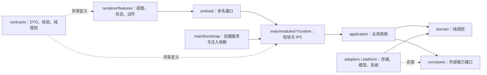

# 岚笺桌面架构

本页描述当前工程的运行边界与职责拆分，不宣告全部 V3 产品能力已验收。目标以[产品基线](PRODUCT-BASELINE.md)为准，存储角色以[数据权威矩阵](DATA-AUTHORITY-MATRIX.md)为准。

## 进程与依赖

- 一个 Electron 桌面包统一构建；不引入服务端或微服务。
- `main/bootstrap/index.ts` 处理应用身份、单实例和生命周期；`create-desktop-runtime.ts` 创建服务、注入端口、协调作品切换与关闭；`create-main-window.ts` 负责安全窗口。
- 各业务 `runtime/ipc.ts` 以显式类型化依赖注册通道；公共校验包装位于 `platform/ipc/validated-ipc.ts`，业务模块不反向导入装配入口。
- `contracts/index.ts` 与 `contracts/ipc.ts` 保留兼容导出。实现分别归属业务 DTO、API、参数校验文件；纯共享规则不能引用 main。
- `AppShell.vue` 组合工作台；`use-workspace-controller.js` 管理模块连接与共同生命周期；业务动作和状态位于各 feature 的 `composables/`。视图使用明确列出的共享 ref，保留同一本书、请求代次和未保存草稿的归属。
- 开发场景位于 `tests/smoke/`。普通生产构建会移除入口；仅开发服务或 `--mode smoke` 构建启用，不在正式启动入口嵌入测试剧本。

## 作者数据边界

主进程拥有文件、SQLite、系统密钥存储与外部模型请求。renderer 只提交作者意图、草稿和版本标识，不能自行指定任意 IPC 通道、读取密钥或直接修改存储。

应用与书稿目录独立。当前正文/大纲的权威由作品实际存储模式决定；来源、候选、历史、恢复数据不被混为一份当前稿。结构化写入沿用共享的作品写入协调器，跨模块操作保留原有版本和身份校验。

AI 上下文由主进程根据已保存材料与有效版本组装，包含分层大纲、四要素事件、自定义境界和系统模板等约束。输出首先进入候选流程；作者采用和正式确认保留各自的语义。

## 窗口与通信

- `contextIsolation: true`、`nodeIntegration: false`、`sandbox: true`。
- preload 暴露固定的类型化功能，不暴露原始 `ipcRenderer`。
- 请求经参数解码后进入用例，异常转换为安全的错误 DTO。
- 外部链接由主进程核验后打开；应用窗口拒绝越界导航和权限请求。
- Python worker 是可选本地推理的子进程，不是产品后端；固定 worker 文件由构建配置发出。

## 可执行检查

`npm run check:architecture` 检查相对导入、跨层反向依赖、运行时循环，以及 renderer/preload 经 barrel、动态导入或 require 间接接触 Node 的情况。类型导入的递归不等于运行时循环。

类型检查、按业务组织的测试，以及临时作品的 Electron 回归共同覆盖接口与运行行为；仅通过静态检查不能替代保存、恢复和作者工作流验证。见[开发说明](DEVELOPMENT.md)。
